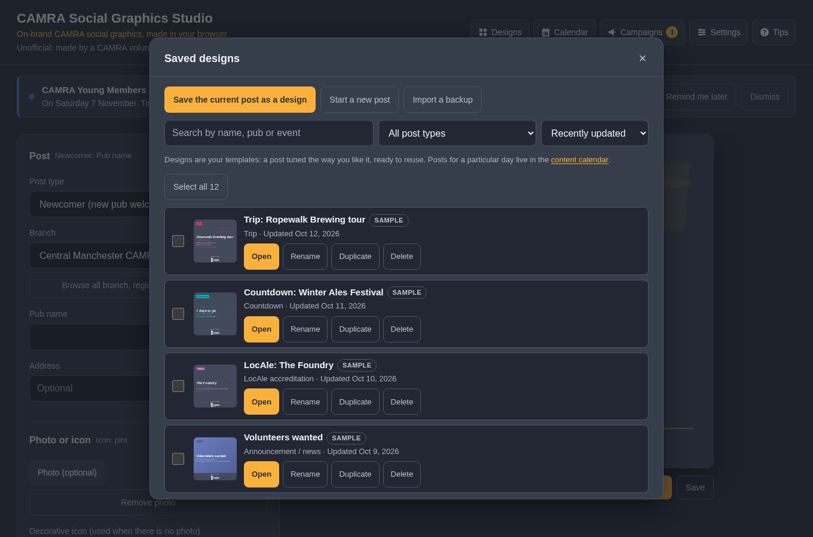
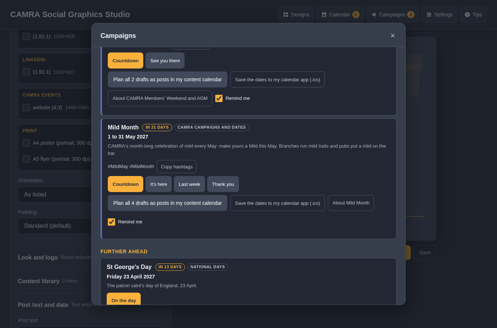
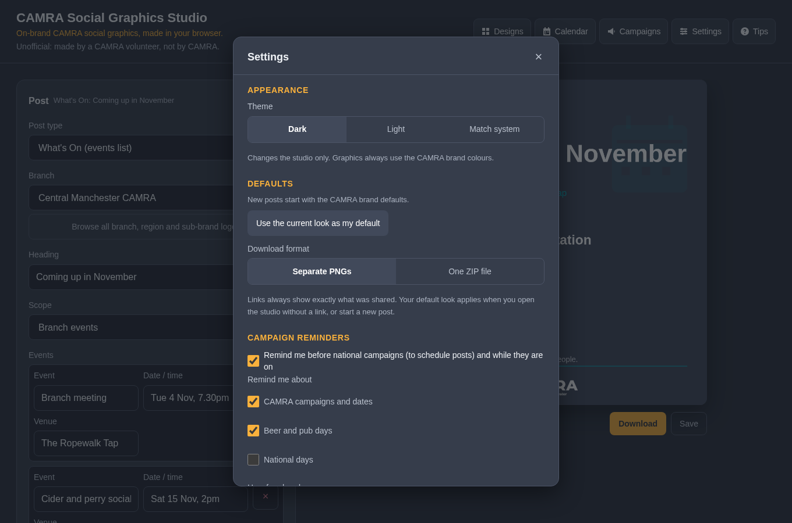
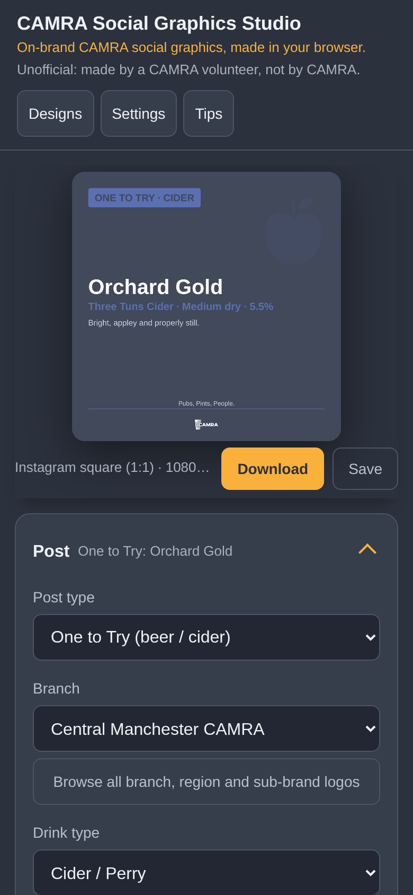
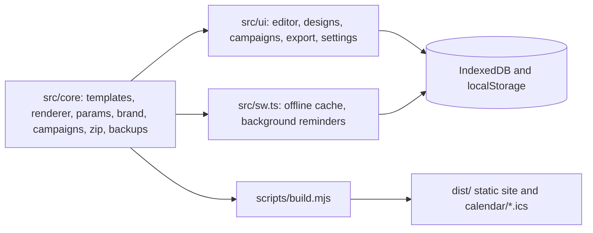

<p align="center"></p>

# CAMRA Social Graphics Studio

An unofficial, static, browser-based studio for making on-brand CAMRA social graphics. Nothing is uploaded. Made by Sean O'Mahoney, a CAMRA volunteer; not affiliated with or endorsed by CAMRA.

Pick a post type, choose your branch or any CAMRA logo, add a photo or an icon and the words that go with it, then download every size you need for Instagram, Facebook, Twitter/X, Bluesky, LinkedIn, the CAMRA Events site and print. Save posts as templates, plan them in a content calendar alongside CAMRA's campaigns and dates, and share them as links. The studio never posts for you, and nothing you add leaves your device.


## Features

Each group links to its section of [docs/FEATURES.md](docs/FEATURES.md), and each feature name links to its full explanation there.

### [Making a graphic](docs/FEATURES.md#making-a-graphic)

- [Post types](docs/FEATURES.md#post-types): 22 ready-made post types plus Custom, each with its own fields and layout.
- [Logo library](docs/FEATURES.md#logo-library): Every CAMRA branch, region and sub-brand logo built in, with a searchable picker and custom uploads.
- [Photos and reframing](docs/FEATURES.md#photos-and-reframing): Add a photo to any post, then frame, fit, nudge, zoom and fade it, the same for every size.
- [Decorative icons](docs/FEATURES.md#decorative-icons): 72 icons for posts without a photo, with a picker, position, size, strength and colour.
- [Colours, text and alignment](docs/FEATURES.md#colours-text-and-alignment): Background colour and gradient, colours and alignment for each kind of text, logo size and position, and the tagline.
- [Brand rules built in](docs/FEATURES.md#brand-rules-built-in): Graphics follow the CAMRA Brand Guidelines by default, with notes, contrast checks and a guidelines panel.
- [Platforms and sizes](docs/FEATURES.md#platforms-and-sizes): Instagram, Facebook, Twitter/X, Bluesky, LinkedIn, the CAMRA Events site and print, in one download.


### [Exporting and sharing](docs/FEATURES.md#exporting-and-sharing)

- [Downloads](docs/FEATURES.md#downloads): Separate PNGs or one ZIP for every ticked size, named by post type and size.
- [Share, copy image and alt text](docs/FEATURES.md#share-copy-image-and-alt-text): The device's share sheet, copy to clipboard, and alt text written from the post.
- [Share links and automation](docs/FEATURES.md#share-links-and-automation): Links that fill the form, auto-download links and a full query parameter reference.

<p>  </p>

### [Designs and the content library](docs/FEATURES.md#designs-and-the-content-library)

- [Designs as templates](docs/FEATURES.md#designs-as-templates): Save a post as a template, then update it or save a new one as it changes.
- [Finding and tidying designs](docs/FEATURES.md#finding-and-tidying-designs): Search, filter, sort, rename, duplicate, select many, and Recently deleted with undo.
- [Content library](docs/FEATURES.md#content-library): Saved logos and photos to reuse in any post.



### [Content calendar](docs/FEATURES.md#content-calendar)

- [Post text](docs/FEATURES.md#post-text): The words that go with the graphic, with character counts for every platform.
- [Saving to the calendar, designs or both](docs/FEATURES.md#saving-to-the-calendar-designs-or-both): One save dialog, with a date that defaults to today and a choice to update or save as new.
- [Repeating posts](docs/FEATURES.md#repeating-posts): Every week, month or year, with an optional end date, marked posted day by day.
- [Month and list views](docs/FEATURES.md#month-and-list-views): A month grid and a list of what is coming up, with campaigns alongside.
- [Working with a planned post](docs/FEATURES.md#working-with-a-planned-post): Open, copy the text, download, share, mark as posted, keep as a design, move or delete.
- [Reminders for planned posts](docs/FEATURES.md#reminders-for-planned-posts): A reminder and a count on Calendar when posts are due, and an .ics plan for calendar apps.


### [Campaigns](docs/FEATURES.md#campaigns)

- [Campaign catalogue](docs/FEATURES.md#campaign-catalogue): CAMRA campaigns and dates, beer and pub days and national days, with dates for any year.
- [Campaign reminders](docs/FEATURES.md#campaign-reminders): A reminder in time to schedule posts, and another while it is on.
- [Campaign drafts](docs/FEATURES.md#campaign-drafts): Ready-made drafts with dates, days to go and post text in CAMRA's own style.
- [Planning a whole campaign](docs/FEATURES.md#planning-a-whole-campaign): Plan all drafts as posts in the content calendar, each on a suggested day.
- [Calendar feeds](docs/FEATURES.md#calendar-feeds): Subscribe in Google, Outlook or Apple Calendar and the dates stay in sync.
- [Notifications](docs/FEATURES.md#notifications): Optional device notifications, asked for only with your consent.



### [Your data and privacy](docs/FEATURES.md#your-data-and-privacy)

- [Nothing leaves your device](docs/FEATURES.md#nothing-leaves-your-device): No uploads, no accounts, and the studio never posts for you.
- [Backups](docs/FEATURES.md#backups): Back up everything or a selection to a ZIP, and import it on another device.
- [Storage](docs/FEATURES.md#storage): See how much space is used, ask the browser to keep it, or delete everything.



### [The studio itself](docs/FEATURES.md#the-studio-itself)

- [Works offline and installs as an app](docs/FEATURES.md#works-offline-and-installs-as-an-app): Install it on a phone or desktop and use it offline.
- [Layout on phones and wide screens](docs/FEATURES.md#layout-on-phones-and-wide-screens): A pinned header, one row of tabs on phones, and resizable panels on wide screens.
- [Themes, tips and accessibility](docs/FEATURES.md#themes-tips-and-accessibility): Dark, light or system theme, a tips walkthrough, and full keyboard and screen reader support.



## Quick start

```sh
npm install
npm run dev        # http://localhost:8080, rebuilds on change
npm run build      # static site in dist/
npm run check      # typecheck, lint, unit tests, docs check, build
npm run test:e2e   # Playwright (npx playwright install chromium first)
```

## Deploying on Cloudflare

Set the build command to `npm run build` and the output directory to `dist`. Node 22 is read from `.nvmrc`. `public/_headers` sets the CSP and caching, and serves the calendar feeds as `text/calendar`. Optionally set the `SITE_URL` environment variable to the site's address so calendar events link back to the studio.

## Architecture



`src/core` has no DOM dependencies and is unit tested in Node. The query parameter reference is generated into [docs/QUERY_PARAMETERS.md](docs/QUERY_PARAMETERS.md) by `npm run docs` from the same schema the app uses.

## Logos

`assets/logos/catalogue.json` lists every branch, region and sub-brand logo with its id; [docs/LOGOS.md](docs/LOGOS.md) is the readable version. To add or replace logos, put white-on-transparent PNGs in a folder and run `python3 scripts/import-logos.py <branches|regions|sub-brands> <folder>`, then `npm run docs`. JPEGs are refused because they cannot be transparent.

## Data

Designs, calendar posts, the content library, the remembered logo and which reminders were dismissed live in this browser's IndexedDB; settings (including campaign reminder settings) in localStorage. Backups are ZIP files with `manifest.json`, `designs.json`, `library.json`, optional `prefs.json` and an `assets/` folder. `seeds/demo.json` holds the sample designs and `seeds/test.json` the edge-case fixtures used by the tests.

## Screenshots

Regenerate with `npm run build && npm run screenshots` (writes `docs/screenshots/`).

## Documentation

[docs/FEATURES.md](docs/FEATURES.md), [docs/CAMPAIGNS.md](docs/CAMPAIGNS.md), [docs/QUERY_PARAMETERS.md](docs/QUERY_PARAMETERS.md), [docs/LOGOS.md](docs/LOGOS.md), [docs/DIVERGENT_THINKING.md](docs/DIVERGENT_THINKING.md) and [CHANGELOG.md](CHANGELOG.md).
