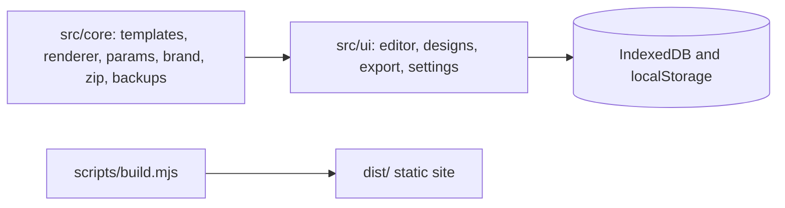

<p align="center"></p>

# CAMRA Social Graphics Studio

An unofficial, static, browser-based studio for making on-brand CAMRA social graphics. Nothing is uploaded. Made by Sean O'Mahoney, a CAMRA volunteer; not affiliated with or endorsed by CAMRA.


## Quick start

```sh
npm install
npm run dev        # http://localhost:8080, rebuilds on change
npm run build      # static site in dist/
npm run check      # typecheck, lint, unit tests, docs check, build
npm run test:e2e   # Playwright (npx playwright install chromium first)
```

## Deploying on Cloudflare

Set the build command to `npm run build` and the output directory to `dist`. Node 22 is read from `.nvmrc`. `public/_headers` sets the CSP and caching.

## Architecture



`src/core` has no DOM dependencies and is unit tested in Node. The query parameter reference is generated into [docs/QUERY_PARAMETERS.md](docs/QUERY_PARAMETERS.md) by `npm run docs` from the same schema the app uses.

## Data

Saved designs, the content library and the remembered logo live in this browser's IndexedDB; settings in localStorage. Backups are ZIP files with `manifest.json`, `designs.json`, `library.json`, optional `prefs.json` and an `assets/` folder. `seeds/demo.json` holds the sample designs and `seeds/test.json` the edge-case fixtures used by the tests.

## Screenshots

Regenerate with `npm run build && npm run screenshots` (writes `docs/screenshots/`).
