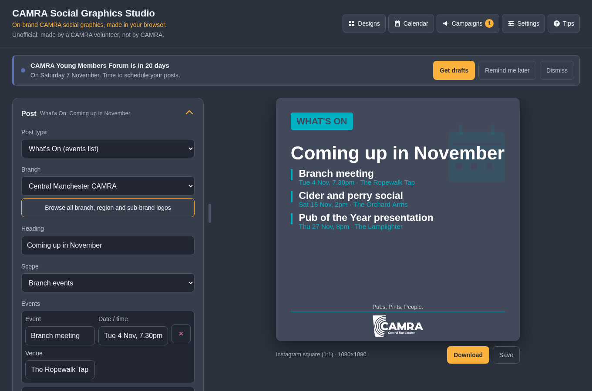
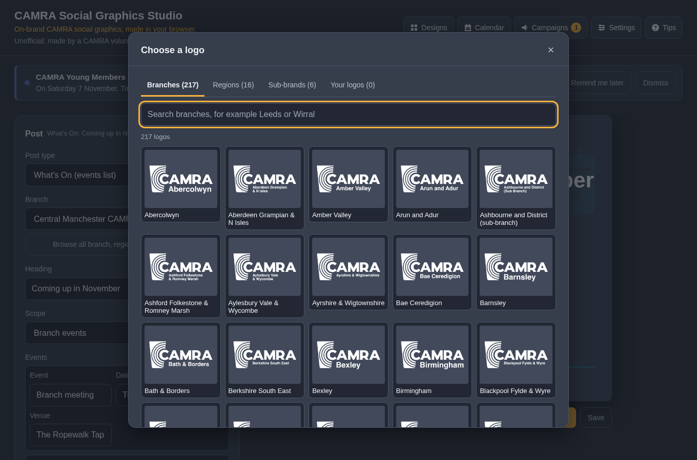
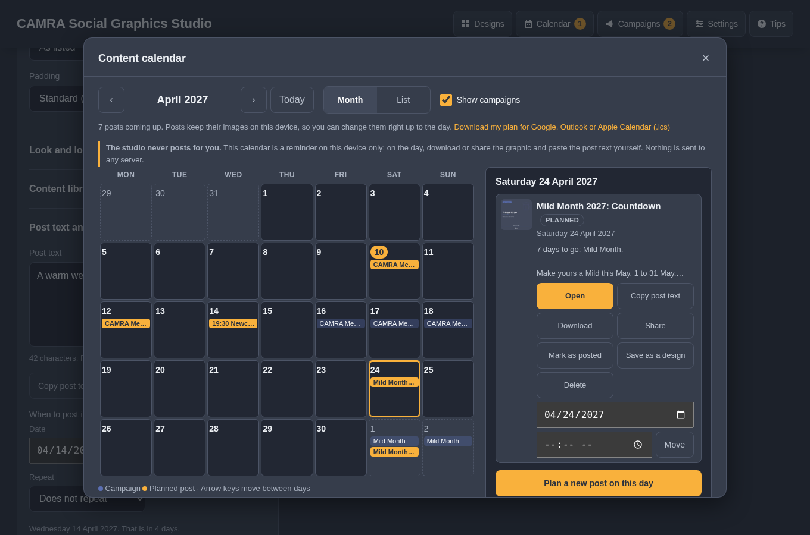
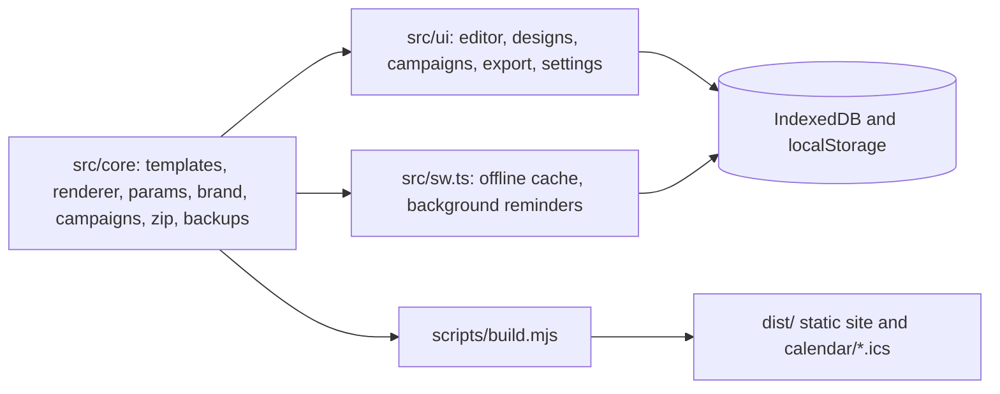

<p align="center"></p>

# CAMRA Social Graphics Studio

An unofficial, static, browser-based studio for making on-brand CAMRA social graphics. Nothing is uploaded. Made by Sean O'Mahoney, a CAMRA volunteer; not affiliated with or endorsed by CAMRA.



## What it does

Pick one of 23 post types (or Custom), choose a branch, region or sub-brand logo from the built-in library of every CAMRA logo, add a photo or a decorative icon, write the text that goes with it, then download every size you need: Instagram, Facebook, Twitter/X, Bluesky, LinkedIn, the CAMRA Events site and print. Designs can be saved as templates, posts planned in a content calendar, shared as links and backed up. The studio never posts anything for you, and nothing you add leaves your device.



## Content calendar

Designs and calendar posts are kept apart. A design is a template: a post tuned the way you like it, to reuse and tweak. A calendar post is something you mean to put out on a day, once or on repeat. One save dialog saves to either or both, and when a design or post is open it can be updated or kept with a copy saved as new.

Under Post text and date, write the words that go with the graphic (the counter shows which platforms it fits) and pick the day, and optionally the time and a repeat (every week, month or year, with an optional end), to post it. Without a date, a post goes on today. Save to calendar keeps every form setting, the text and local copies of every image, so the post can be reopened and changed at any point before the day. The text travels in share links as `copy`; the date stays on this device.

The studio never posts for you. The calendar is a reminder on this device: on the day, download or share the graphic and paste the text yourself. Reminders only appear if they are on, notifications only with the browser's permission, and nothing is sent to any server.

The Calendar button opens a month view and a list of what is coming up. Planned posts and campaigns sit side by side; choosing a day shows both, with buttons to open, copy the text of, download, share (through the device's share sheet), mark as posted, keep as a design, move or delete each post, and to plan a new one. Campaign drafts can be planned in one go from Campaigns, each on a suggested day, and a countdown recounts its days to go when moved. On the day, a reminder appears under the top bar and Calendar shows a count. The plan can be downloaded as an .ics file for any calendar app; unlike the campaign feeds it is a snapshot, because the plan only exists in this browser.



## Campaigns

The studio knows the national and annual campaigns branches post about: Mild Month, Cider and Perry Month, the Good Beer Guide launch, Members' Weekend, Volunteers' Week, Champion Beer of Britain, Heritage Open Days, the Young Members Forum, Cask Ale Week, Beer Day Britain and more, listed in [docs/CAMPAIGNS.md](docs/CAMPAIGNS.md). Before each one starts (two to six weeks ahead, depending on the campaign) a reminder appears under the top bar so there is time to schedule posts, and another appears while it is on. Each reminder opens the Campaigns panel, where every campaign has ready-made drafts (countdown, launch, last week, thank you) that open in the editor with your branch and default look, the dates, days to go and suggested post text already filled in. Plan all drafts as posts adds them to the studio's own content calendar; Save the dates to my calendar app downloads an .ics file for Google, Outlook or Apple Calendar instead.

Reminders can be snoozed, dismissed, muted per campaign, or limited to CAMRA campaigns, beer and pub days or national days in Settings. Turning on system notifications shows them as device notifications too; an installed copy in Chrome or Edge can also check while closed. Everything is worked out on the device from the bundled list.

The build publishes the same list as calendar feeds in `calendar/`: `campaigns.ics` (everything), `camra.ics` (CAMRA only) and `planning.ics` (a reminder on the day to start scheduling, for calendars such as Google that ignore alarms in subscribed feeds). Subscribe from the Campaigns panel and the calendar stays in sync with every redeploy. Set `SITE_URL` (for example `https://graphics.example.org/`) in the build environment to add a link back to each campaign's drafts in the events.

To add a campaign or confirm a year's dates, edit `src/core/data/campaigns.json` and run `npm run docs`.

## Quick start

```sh
npm install
npm run dev        # http://localhost:8080, rebuilds on change
npm run build      # static site in dist/
npm run check      # typecheck, lint, unit tests, docs check, build
npm run test:e2e   # Playwright (npx playwright install chromium first)
```

## Deploying on Cloudflare

Set the build command to `npm run build` and the output directory to `dist`. Node 22 is read from `.nvmrc`. `public/_headers` sets the CSP and caching, and serves the calendar feeds as `text/calendar`. Optionally set the `SITE_URL` environment variable to the site's address so calendar events link back to the studio.

## Architecture



`src/core` has no DOM dependencies and is unit tested in Node. The query parameter reference is generated into [docs/QUERY_PARAMETERS.md](docs/QUERY_PARAMETERS.md) by `npm run docs` from the same schema the app uses.

## Logos

`assets/logos/catalogue.json` lists every branch, region and sub-brand logo with its id; [docs/LOGOS.md](docs/LOGOS.md) is the readable version. To add or replace logos, put white-on-transparent PNGs in a folder and run `python3 scripts/import-logos.py <branches|regions|sub-brands> <folder>`, then `npm run docs`. JPEGs are refused because they cannot be transparent.

## Data

Designs, calendar posts, the content library, the remembered logo and which reminders were dismissed live in this browser's IndexedDB; settings (including campaign reminder settings) in localStorage. Backups are ZIP files with `manifest.json`, `designs.json`, `library.json`, optional `prefs.json` and an `assets/` folder. `seeds/demo.json` holds the sample designs and `seeds/test.json` the edge-case fixtures used by the tests.

## Screenshots

Regenerate with `npm run build && npm run screenshots` (writes `docs/screenshots/`).
