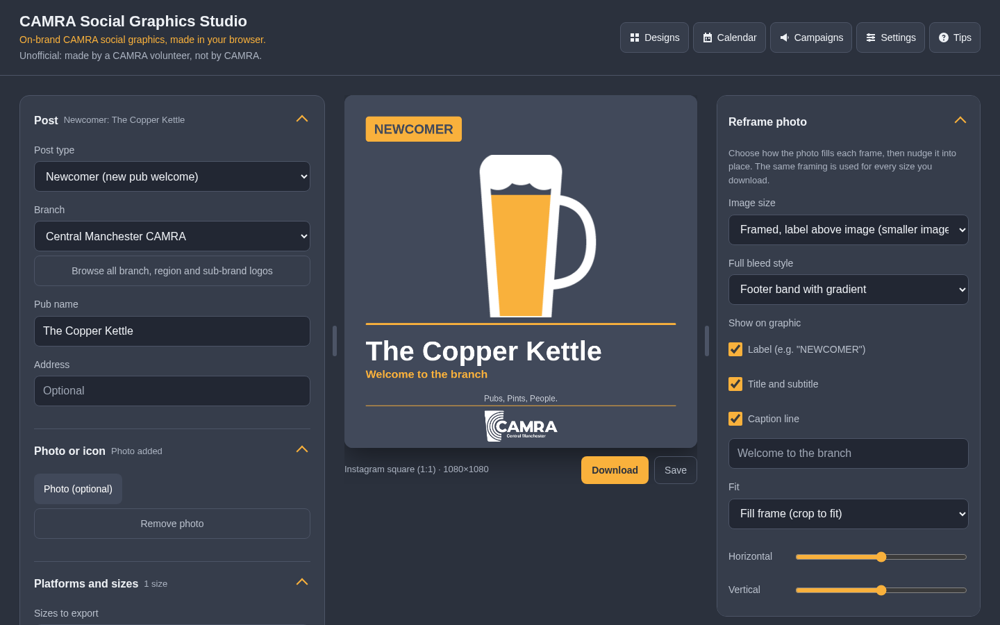
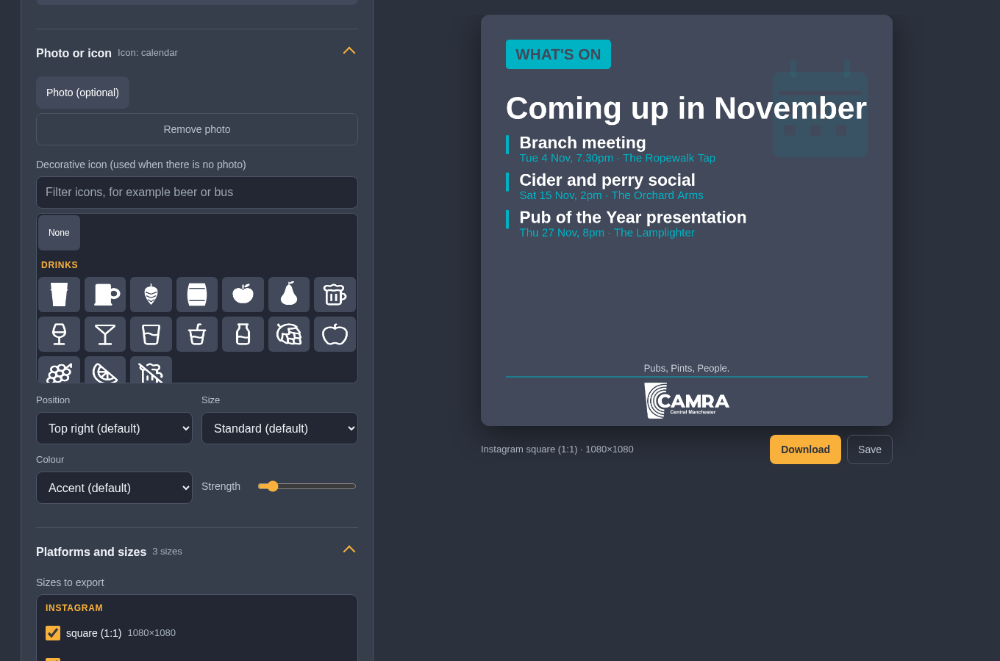
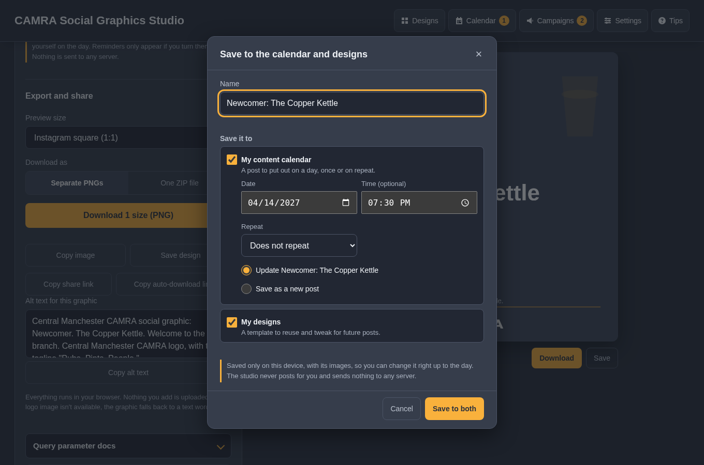
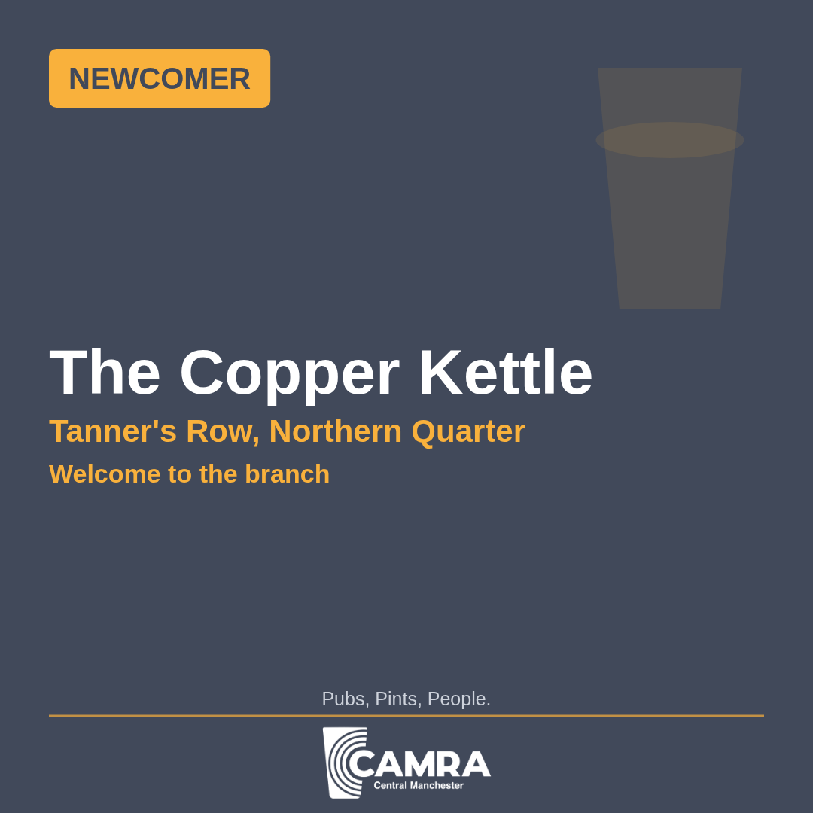
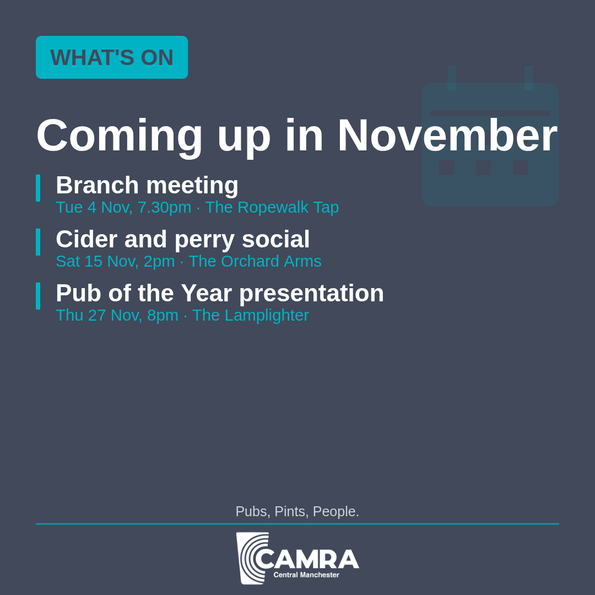
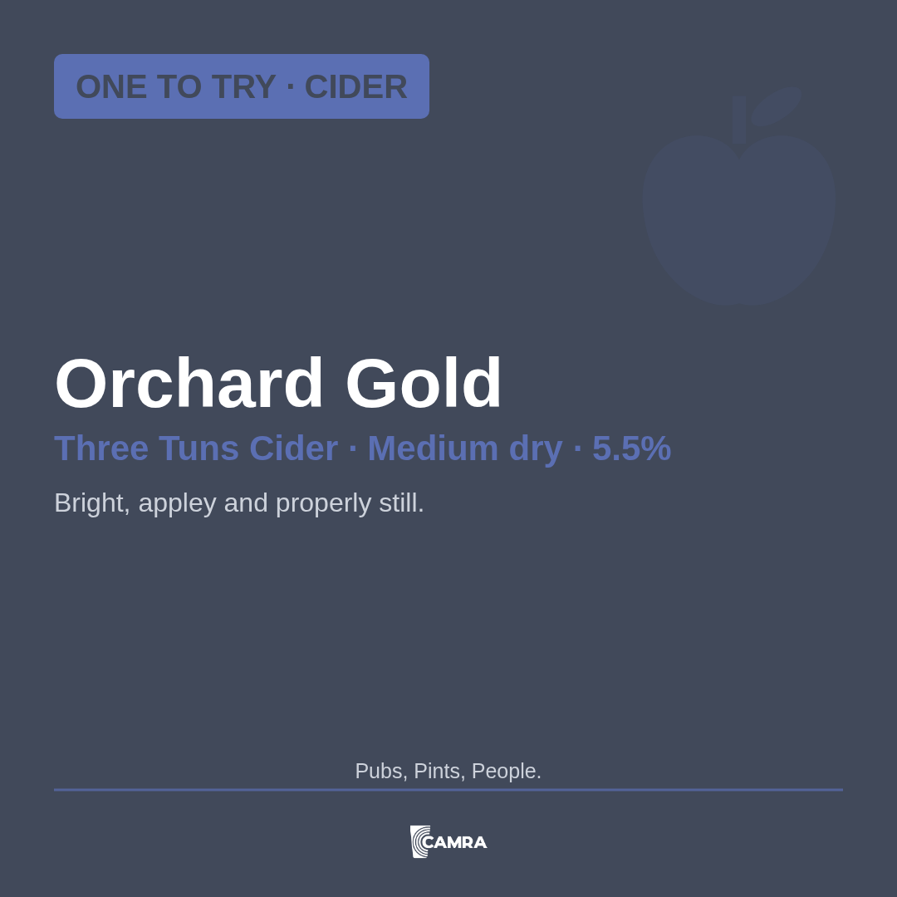
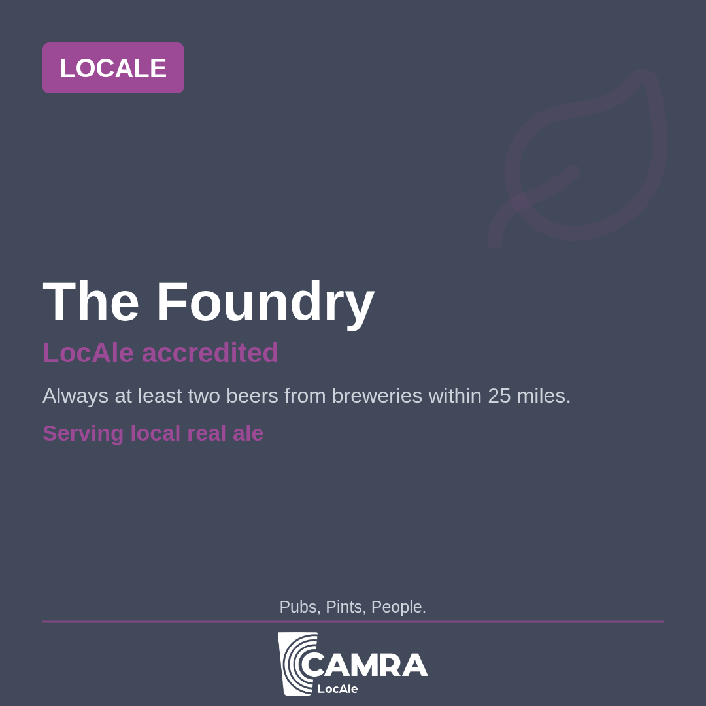
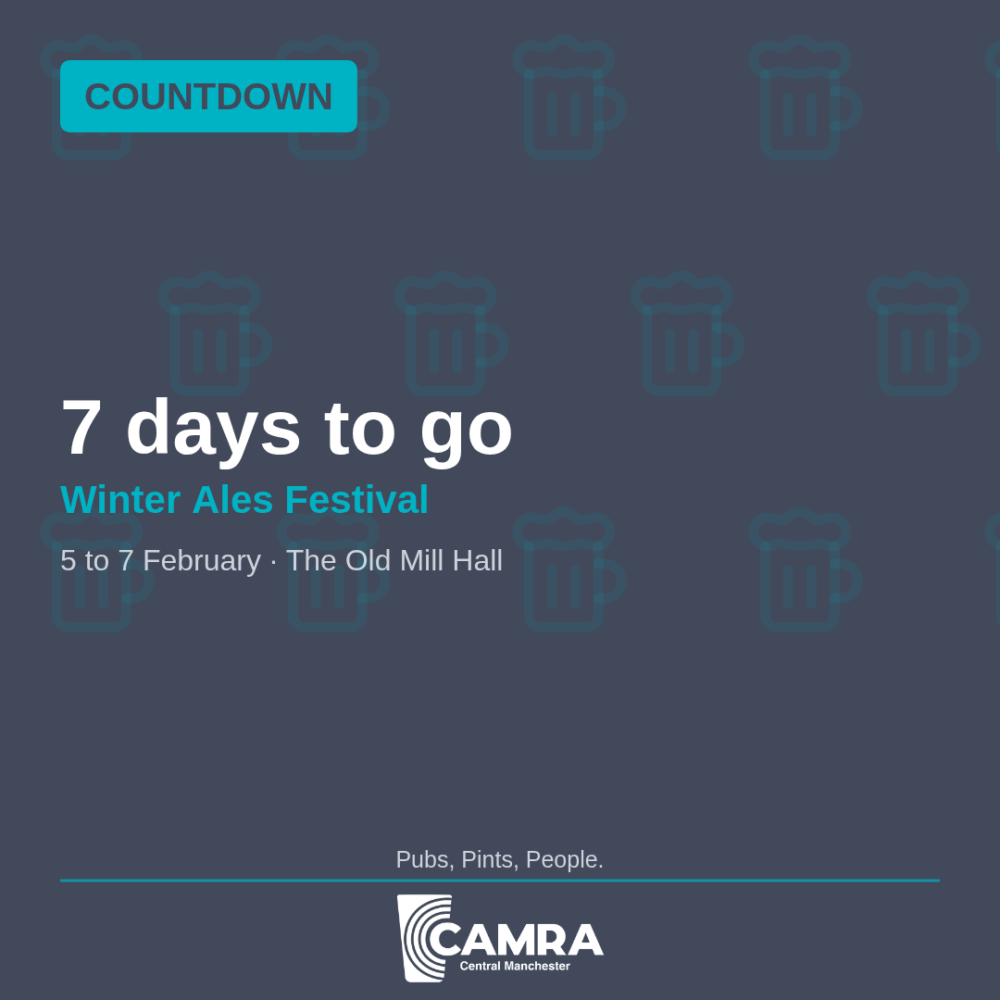
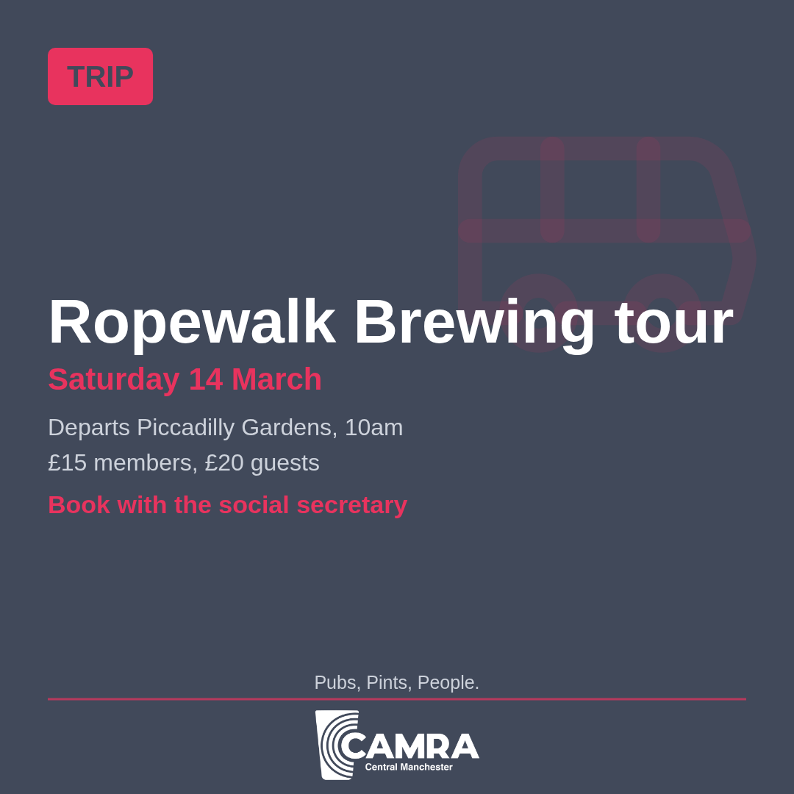

# Features

What the CAMRA Social Graphics Studio does, in detail. The [README](../README.md) has the short version.

## Contents

- [Making a graphic](#making-a-graphic)
- [Exporting and sharing](#exporting-and-sharing)
- [Designs and the content library](#designs-and-the-content-library)
- [Content calendar](#content-calendar)
- [Campaigns](#campaigns)
- [Your data and privacy](#your-data-and-privacy)
- [The studio itself](#the-studio-itself)

## Making a graphic

Everything that decides how a graphic looks. Fields change with the post type, the preview redraws as you type, and the brand rules are applied for you.

### Post types

Pick what kind of post you are making and the form shows only the fields it needs: Newcomer, Award presentation, What's On, Social tour, Hybrid (award plus social), Meeting or AGM, Festival, Pub feature or Pub of the Month, One to Try, Announcement, Pub news, LocAle accreditation, Pub heritage, Pub campaign (save our pub), Good Beer Guide, National campaign, Beer or pub day, Trip, Countdown, Volunteers wanted, Join CAMRA, Thank you and Custom. The Post type list is grouped so the right one is quick to find.

List fields (events, pubs on a crawl, social stops, roles, benefits) take as many rows as you need. National campaign and Beer or pub day posts have a Stage (coming soon, countdown, on now, today, last week, thank you) that sets the label and heading, with Dates and Days to go. Custom gives a free label, title, subtitle and body, or an image on its own.

### Logo library

All 217 branch logos, 16 region logos and 6 sub-brands (LocAle, Pub Heritage, Community Pubs, Cider and Perry, What's Brewing, OCR Pubs) are built in. Browse all branch, region and sub-brand logos opens a picker with search, and Logo shown chooses between the automatic brand default, the CAMRA logo, the branch, a region or a sub-brand. LocAle and Pub heritage posts use their own logo automatically.

A branch that is not listed can pick Custom, type its name and upload a white PNG logo, which can be remembered on the device. One logo shows on each graphic, never two, with a minimum size so small text in branch logos stays readable.

### Photos and reframing

Photos work on every post type. Image size chooses between a framed photo with the label above it, a larger framed photo with the label on it, or full bleed to the edges, with either a footer band and gradient or a curved corner panel holding the logo. Fit crops to fill, letterboxes the whole image or stretches it.

Horizontal, Vertical and Zoom nudge the photo into place, Opacity fades it back so text reads more easily, and the label, title and subtitle and caption line can each be shown or hidden, with your own caption text. The same framing is used for every size you download. On a wide screen the Reframe photo panel sits beside the preview.

### Decorative icons

Posts without a photo carry a faint decorative icon. A visual picker with a filter offers 10 solid icons and 62 line icons (pints, cider, hops, trophies, buses, calendars, landmarks and more). Position puts it top right, top left, bottom left, centred behind the text or as a pattern across the background; Size, Strength and Colour (accent, white, grey, any brand colour or a custom colour) finish it.

### Colours, text and alignment

Background colour takes any CAMRA brand colour or a custom one, solid or as a subtle gradient. Title, subtitle, body text and caption each get their own colour and left or centred alignment. Logo size has Standard, Larger and Massive presets plus a slider, and the logo can sit left, centre or right. The tagline is one of the approved CAMRA taglines, or off, aligned left or centre.

Reset to brand defaults puts the look back, and Make this my default look starts every new post from your own colours and settings.

### Brand rules built in

The studio applies the brand rules as you go: campaign posts (One to Try, Real Cider and Perry, national campaigns) show the CAMRA logo, cider and perry posts take Blue, award results take gold, silver or bronze, and the CAMRA logo always keeps its slate band. Notes under the form explain each choice, and a warning appears if you deliberately choose something off-brand.

A contrast check warns when a text colour is hard to read against its background. Brand guidelines, at the foot of the form, explains why graphics look the way they do, with examples for each post type and level of the brand hierarchy, and links to the official CAMRA Brand Hub. Arboria is used when its licensed web font files are supplied, with Arial as the approved fallback.

### Platforms and sizes

Tick every size you need and one download makes each of them: Instagram square, portrait and story; Facebook square, landscape, story and event cover; Twitter/X landscape and square; Bluesky; LinkedIn; the CAMRA Events website (4:3); and A4 poster and A5 flyer at 300 dpi for print.

Orientation flips every selected size to landscape or portrait, and Padding adds breathing room, up to a spacious setting that keeps content inside Facebook's safe area. Preview size chooses which ticked size the preview shows.

## Exporting and sharing

Ways to get a finished graphic out of the studio, or to hand someone a ready-made post.

### Downloads

Download makes a PNG for every ticked size, named after the post type, size and dimensions. Download as One ZIP file puts them all in one file, which is easier on phones; on iPhone and iPad several sizes always come as a ZIP, because Safari only allows one download at a time. Progress shows while the sizes export.

### Share, copy image and alt text

Where the browser supports it, Share image sends the graphic straight to another app through the device's share sheet, and Copy image puts it on the clipboard. Alt text is written from the post for blind and partially sighted people, ready to copy into the platform's alt text box.

### Share links and automation

Everything in the form can be set from the address, so Copy share link hands someone a ready-made post, and Copy auto-download link exports the selected sizes as soon as it opens (add `zip=1` for one ZIP). Photos and logos can come from a link where the host allows it. Every parameter is listed in [QUERY_PARAMETERS.md](QUERY_PARAMETERS.md), generated from the same definitions the studio uses, and in the studio under Query parameter docs.

## Designs and the content library

Designs are your templates: a post tuned the way you like it, kept to reuse and tweak. Posts for a particular day live in the content calendar instead.

### Designs as templates

Save design keeps the whole post: every setting, the text and its images. Opening a design fills the form so you can change it for today's post and save that to the calendar, or improve the template itself. Saving a design you opened offers Update the design or Save as a new design, so templates never get overwritten by accident.

### Finding and tidying designs

Search by name, pub or event, filter by post type and sort by recently updated, recently created or name. Designs can be renamed, duplicated and exported, one at a time or ticked together. Deleting moves a design to Recently deleted, with Undo straight away and Restore for 30 days, after which it is removed for good. Sample designs show what the studio can do and can be loaded at any time.

### Content library

Save current logo and Save current photo keep images in the content library on this device, scaled down to save space, ready to reuse in any post with one click.

## Content calendar

The calendar holds posts you mean to put out on a day. It is a reminder on your device: the studio never posts anything for you.

### Post text

Post text and date holds the words you will post with the graphic, hashtags included. The count shows which platforms it fits (X 280, Bluesky 300, Threads 500, Instagram 2,200 and LinkedIn 3,000 characters) and Copy post text puts it on the clipboard. The text is saved with designs and posts and travels in share links.

### Saving to the calendar, designs or both

Save opens one dialog that saves to the content calendar, to designs, or both. A calendar post takes a date (today when none is picked), an optional time and a repeat. When a post or design is open, the dialog offers to update it or save a new one. Everything is kept on the device with local copies of its images, so a post can be changed right up to the day. Ctrl or Cmd + S opens the same dialog.

### Repeating posts

A calendar post can repeat every week, month or year from its first day, until an optional end date. It shows on every day it falls on and each day is marked as posted on its own. Monthly posts on the 31st skip shorter months and yearly posts on 29 February skip other years, as calendar apps do.

### Month and list views

Calendar opens a month view, with planned posts and campaigns on each day, and a list of the next three months. Picking a day shows its posts and campaigns, with Plan a new post on this day and a button to plan or move the open post there. Arrow keys move between days, Page Up and Page Down between months, and weeks can start on Monday or Sunday.

### Working with a planned post

Each post on the calendar can be opened in the editor, have its text copied, its graphics downloaded or shared through the device's share sheet without opening it, be marked as posted (or not), be kept as a design to reuse, be moved to another date or time, or be deleted to Recently deleted. Moving a campaign countdown recounts its days to go.

### Reminders for planned posts

On the day a post is due, a reminder appears under the top bar and Calendar shows a count, along with earlier posts not yet marked as posted. With notifications turned on they arrive as device notifications too. Download my plan saves the planned posts, repeats included, as an .ics file for Google, Outlook or Apple Calendar; it is a snapshot, because the plan only exists on this device.

## Campaigns

National and annual campaigns and days, with reminders before and during each one and drafts ready to post.

### Campaign catalogue

The studio knows the campaigns branches post about, from Mild Month, Cider and Perry Month, the Good Beer Guide launch, Members' Weekend, Volunteers' Week, Champion Beer of Britain, Heritage Open Days and the Young Members Forum to Cask Ale Week, Beer Day Britain, IPA Day and the national days. Dates are worked out for any year, confirmed dates are used where they are published, and estimated ones are marked. The full list is in [CAMPAIGNS.md](CAMPAIGNS.md).

### Campaign reminders

Before each campaign (two to six weeks ahead, depending on the campaign) a reminder appears under the top bar so there is time to schedule posts, and another appears while it is on. Reminders can be snoozed, dismissed, muted per campaign, set further ahead, or limited to CAMRA campaigns and dates, beer and pub days or national days in Settings.

### Campaign drafts

Every campaign has drafts (for example a countdown, launch, last week and thank you) that open in the editor with your branch and default look, the dates and days to go filled in, and suggested post text and hashtags written in the style CAMRA uses on social media. Each is suggested for a sensible day, and drafts that suit any time are suggested for today.

### Planning a whole campaign

Plan all drafts as posts in my content calendar adds a campaign's whole set to the studio's calendar in one go, each on its suggested day and without duplicates, ready to change before posting. Save the dates to my calendar app is different: it downloads the campaign's dates as an .ics file for Google, Outlook or Apple Calendar.

### Calendar feeds

The build publishes the campaigns as calendar feeds: everything, CAMRA only, and planning reminders (one on the day to start scheduling, for calendars such as Google that ignore alarms in subscribed feeds). Subscribing from the Campaigns panel keeps the calendar in step with every update to the site.

### Notifications

Turning on notifications in Settings explains what they are before the browser asks for permission. Campaign and post reminders then arrive as device notifications, and an installed copy in Chrome or Edge can check while the studio is closed. They are worked out on the device from what is saved there.

## Your data and privacy

The studio is a static site. Everything you add stays in your browser and nothing is sent to any server.

### Nothing leaves your device

Photos, logos, designs, calendar posts and settings are stored only in this browser. The studio never posts anything on your behalf: on the day, you download or share the graphic and post it yourself. This is said plainly in the editor, the save dialog, the calendar and Settings.

### Backups

Download backup saves designs and calendar posts (optionally including recently deleted ones), the content library and settings to one ZIP. Importing shows what it will add before anything changes, then merges, overwrites or adds copies. Selected designs can be exported on their own from the Designs panel.

### Storage

Settings shows how much storage is used and how many designs, posts and library items there are, can ask the browser to keep the data even when space runs low, and can delete everything the studio has stored.

## The studio itself

How the studio fits around you, on a phone or a wide screen.

### Works offline and installs as an app

The studio is a Progressive Web App: install it from the browser menu (or Add to Home Screen on iPhone and iPad) and it opens like an app and works offline after the first visit, picking up updates whenever it is opened online.

### Layout on phones and wide screens

The header stays pinned to the top and slims down as you scroll, so Designs, Calendar, Campaigns, Settings and Tips are always in reach; on phones they sit in one row of tabs and the preview stays pinned above the form. On a wide screen the settings and Reframe photo panels either side of the preview can be resized by dragging the dividers or from the keyboard, and the widths are remembered.

### Themes, tips and accessibility

Choose a dark, light or system theme. A short tips walkthrough shows on the first visit and can be replayed from Tips. Every control works from the keyboard with visible focus, dialogs trap focus and close with Escape, and the studio is tested against WCAG 2.2 AA in both themes.

## Example graphics

Exported from the sample designs, exactly as a volunteer would download them.

  

  

